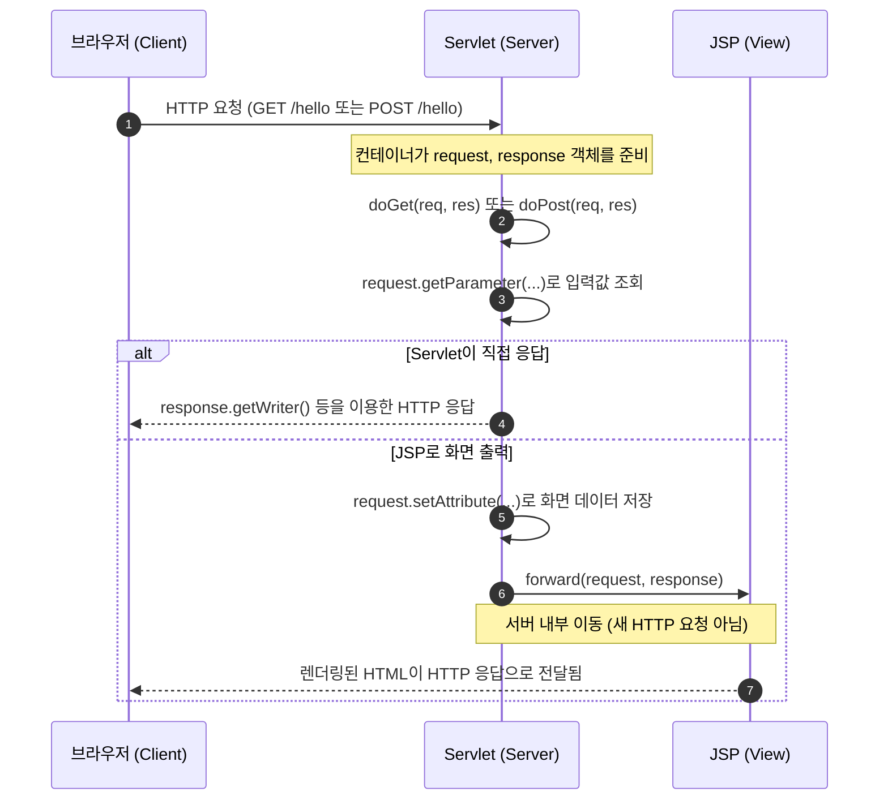
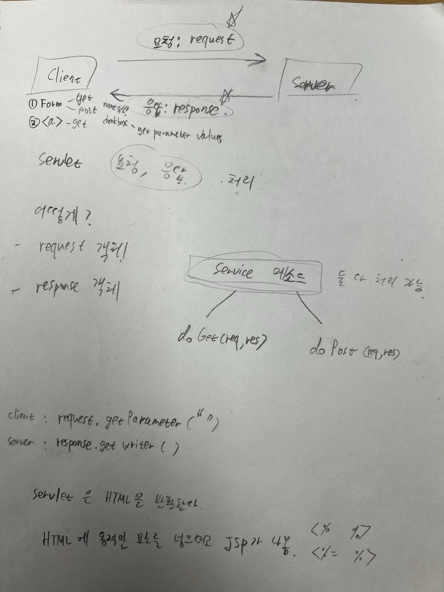

# Servlet과 JSP의 HTTP 요청·응답 흐름

> **핵심 요약**  
> 브라우저(Client)는 HTTP **요청(Request)** 을 보내고, 서버(Server)는 요청을 처리한 뒤 HTTP **응답(Response)** 을 돌려준다.  
> **Servlet**은 요청과 비즈니스 처리 흐름을 담당할 수 있고, **JSP**는 서버에서 HTML 화면을 생성하는 데 사용한다.

## 1. 전체 흐름 한눈에 보기



**꼭 구분할 것**

- 브라우저가 보내는 것은 **HTTP 요청 메시지**다. `HttpServletRequest` 객체 자체를 보내는 것이 아니다.
- 서블릿 컨테이너(예: Tomcat)가 HTTP 요청을 받아 `HttpServletRequest`와 `HttpServletResponse` 객체를 준비해 서블릿에 전달한다.
- `request`는 **요청 정보 읽기**, `response`는 **응답 작성**에 사용한다.
- Servlet은 반드시 HTML만 응답하는 것이 아니다. HTML, JSON, 텍스트, 파일 등을 반환할 수 있다.

---

## 2. GET과 POST는 어떻게 요청되는가?

| 구분 | GET | POST |
|---|---|---|
| 주된 용도 | 데이터 조회 | 데이터 전송·등록·변경 요청 |
| 일반적인 파라미터 위치 | URL의 쿼리 문자열 | HTTP 요청 본문(폼 제출 시) |
| HTML `<form>`에서 사용 | `method="get"` | `method="post"` |
| 일반적인 `<a href="...">` 클릭 | GET 요청 | 해당 없음 |
| Servlet의 처리 메서드 | `doGet(req, res)` | `doPost(req, res)` |

> **주의:** POST라고 해서 값이 자동으로 암호화되는 것은 아니다. 민감한 데이터는 HTTPS로 전송해야 한다. 또한 GET/POST는 HTTP 메서드이며, 서버의 설계에 따라 사용 목적이 달라질 수 있다.

### 2-1. GET: 링크 클릭

```html
<a href="hello?name=Kim">GET 요청 보내기</a>
```

브라우저는 다음과 같은 요청을 보낸다.

```http
GET /앱경로/hello?name=Kim HTTP/1.1
```

서블릿에서는 `request.getParameter("name")`으로 `Kim`을 읽을 수 있다.

### 2-2. POST: 폼 제출

```html
<form action="hello" method="post">
    <label>
        이름: <input type="text" name="name">
    </label>

    <label>
        <input type="checkbox" name="skill" value="Java"> Java
    </label>
    <label>
        <input type="checkbox" name="skill" value="Spring"> Spring
    </label>

    <button type="submit">전송</button>
</form>
```

- `action="hello"` : 요청을 보낼 경로 (현재 페이지 위치를 기준으로 하는 상대 경로)
- `method="post"` : HTTP POST 방식으로 제출
- `name="name"` : 서버가 입력값을 찾는 **파라미터 이름**
- `value="Java"` : 체크박스를 선택했을 때 전송되는 **파라미터 값**
- 같은 `name="skill"`이 여러 개일 수 있으므로 복수 값을 배열로 조회할 수 있다.
- 선택하지 않은 체크박스의 값은 일반적으로 전송되지 않는다.

---

## 3. Servlet은 요청과 응답을 어떻게 처리하는가?

```java
import java.io.IOException;
import jakarta.servlet.ServletException;
import jakarta.servlet.annotation.WebServlet;
import jakarta.servlet.http.HttpServlet;
import jakarta.servlet.http.HttpServletRequest;
import jakarta.servlet.http.HttpServletResponse;

@WebServlet("/hello")
public class HelloServlet extends HttpServlet {

    // GET /hello?name=Kim
    @Override
    protected void doGet(HttpServletRequest request,
                         HttpServletResponse response) throws IOException {
        String name = request.getParameter("name");

        response.setContentType("text/plain; charset=UTF-8");
        response.getWriter().println("GET 요청을 받았습니다.");
        // 실제 응답에서 이름을 출력한다면 적절한 이스케이프 처리가 필요하다.
    }

    // POST /hello
    @Override
    protected void doPost(HttpServletRequest request,
                          HttpServletResponse response)
            throws ServletException, IOException {

        // POST 폼 값 읽기 전에 문자 인코딩 지정
        request.setCharacterEncoding("UTF-8");

        String name = request.getParameter("name");
        String[] skills = request.getParameterValues("skill");

        // JSP에 전달할 서버 내부 데이터
        request.setAttribute("userName", name);
        request.setAttribute("skillsText",
                skills == null ? "선택 없음" : String.join(", ", skills));

        // 같은 request/response를 JSP로 전달
        request.getRequestDispatcher("/WEB-INF/views/result.jsp")
               .forward(request, response);
    }
}
```

### 핵심 메서드 비교

| 메서드 | 목적 | 예시 |
|---|---|---|
| `request.getParameter("name")` | 폼·쿼리 파라미터 값 **하나** 가져오기 | `"Kim"` |
| `request.getParameterValues("skill")` | 같은 이름의 파라미터 값 **여러 개** 가져오기 | `["Java", "Spring"]` |
| `request.setAttribute("key", value)` | JSP 등 서버 내부에 데이터 전달 | `"userName"` 저장 |
| `request.getRequestDispatcher(...).forward(...)` | 현재 요청을 서버 내부의 JSP 등으로 넘김 | `result.jsp` 실행 |
| `response.setContentType(...)` | 응답 본문의 타입·문자 인코딩 지정 | `text/plain; charset=UTF-8` |
| `response.getWriter()` | 문자 기반 응답 본문 작성 | `println(...)` |

> **중요:** `getParameter()`는 클라이언트가 전송한 **요청 파라미터**를 읽고, `getAttribute()`는 서버가 `setAttribute()`로 저장한 **서버 내부 속성**을 읽는다. 두 메서드는 다르다.

---

## 4. JSP는 어떤 역할을 하는가?

서블릿이 요청을 처리한 뒤 JSP에 데이터를 넘기면, JSP는 서버에서 HTML을 생성하고 그 결과가 브라우저에 반환된다.

**`/WEB-INF/views/result.jsp`**

```jsp
<%@ page contentType="text/html; charset=UTF-8" pageEncoding="UTF-8" %>
<%@ taglib prefix="c" uri="jakarta.tags.core" %>
<!DOCTYPE html>
<html lang="ko">
<head>
    <meta charset="UTF-8">
    <title>제출 결과</title>
</head>
<body>
    <h1>폼 제출 결과</h1>
    <p>이름: <c:out value="${userName}" /></p>
    <p>선택 기술: <c:out value="${skillsText}" /></p>
</body>
</html>
```

- `${userName}` : JSP EL(Expression Language)로 request 속성에 접근한다.
- `<c:out>` : 출력 텍스트를 HTML 이스케이프하여 사용자 입력 출력 시 유용하다. **위 JSP 예제를 실행하려면 Jakarta Tags(JSTL) 라이브러리가 프로젝트에 필요하다.**
- `/WEB-INF/views/` 아래 JSP는 보통 브라우저가 직접 URL로 열 수 없고, 서버 내부에서 `forward()`하는 용도로 사용한다.

### JSP에서 Java를 직접 사용하던 문법

| 문법 | 의미 | 예시 |
|---|---|---|
| `<% ... %>` | 스크립틀릿: Java 문장 실행 | `<% int count = 3; %>` |
| `<%= ... %>` | 표현식: 계산 결과를 응답 본문에 출력 | `<%= count %>` |
| `${...}` | EL: JSP에서 데이터 참조 | `${userName}` |

JSP는 내부적으로 **서블릿으로 변환·컴파일되어 실행**된다. 따라서 JSP 역시 서버에서 동작하는 기술이다.

현대적인 JSP 코드에서는 화면과 Java 로직을 섞는 스크립틀릿(`<% ... %>`)보다는 **EL + JSTL**을 사용하는 편이 유지보수에 유리하다. 새 프로젝트에서는 Thymeleaf나 프런트엔드 프레임워크와 REST API를 조합하는 구성도 흔하다.

---

## 5. 요청 한 번을 추적해 보기

사용자가 이름을 `Kim`으로 입력하고 `Java`, `Spring` 체크박스를 모두 선택한 뒤 제출했다고 가정한다.

1. **브라우저**가 `POST /hello` 요청을 보낸다. 일반적인 HTML 폼 제출에서는 입력값이 요청 본문에 포함된다.
2. **서블릿 컨테이너**가 요청을 받아 `/hello`에 연결된 `HelloServlet`의 `doPost()`를 호출한다.
3. **Servlet**이 `getParameter("name")`으로 `Kim`, `getParameterValues("skill")`로 `["Java", "Spring"]`을 읽는다.
4. **Servlet**이 `setAttribute()`로 화면에 표시할 데이터를 저장한다.
5. **Servlet**이 `forward()`로 `result.jsp`에 처리를 넘긴다. 이 단계에서 브라우저의 새 요청은 발생하지 않는다.
6. **JSP**가 전달받은 속성을 사용해 HTML을 생성한다.
7. **브라우저**가 최종 HTTP 응답으로 받은 HTML을 렌더링한다.

```text
[Browser]
  | POST /hello (name=Kim, skill=Java, skill=Spring)
  v
[HelloServlet.doPost()]
  | getParameter() / getParameterValues()
  | setAttribute()
  | forward(request, response)
  v
[result.jsp]
  | HTML 생성
  v
[Browser: 결과 화면]
```

## 6. 자주 혼동하는 개념

| 질문 | 답변 |
|---|---|
| `request`, `response`는 브라우저에서 만든 Java 객체인가? | 아니다. 브라우저는 HTTP 메시지를 보내며, 서블릿 컨테이너가 서버 측 객체를 제공한다. |
| `<a>`로 POST 요청을 보낼 수 있나? | 일반적인 링크 클릭은 GET이다. POST는 보통 `<form method="post">`나 JavaScript `fetch()` 등으로 전송한다. |
| `name`과 `id`는 같은가? | 아니다. 폼 데이터의 파라미터 이름에는 주로 `name`이 사용된다. `id`는 문서 내 요소 식별 등에 쓰인다. |
| 체크박스에서 왜 `getParameterValues()`를 쓰나? | 같은 `name`을 가진 체크박스를 여러 개 선택할 수 있기 때문이다. |
| Servlet은 반드시 JSP를 호출해야 하나? | 아니다. `response.getWriter()` 등으로 직접 응답을 만들 수 있다. |
| `forward()`와 `sendRedirect()`는 같은가? | 아니다. `forward()`는 서버 내부에서 현재 요청을 전달하고, `sendRedirect()`는 브라우저에 다른 URL로 다시 요청하도록 응답한다. |

---

## 7. 최종 암기 포인트

- **Client → Server:** HTTP Request
- **Server → Client:** HTTP Response
- **GET:** 일반적으로 조회에 사용하며, `doGet()`이 처리
- **POST:** 일반적으로 데이터 제출에 사용하며, `doPost()`가 처리
- **`getParameter()` / `getParameterValues()`:** 요청 파라미터 하나 / 여러 개
- **`setAttribute()` + `forward()`:** 서블릿에서 JSP로 서버 내부 데이터 전달
- **`response.getWriter()`:** Servlet에서 응답 본문 직접 작성
- **JSP:** HTML 화면 생성용 서버 측 템플릿이며 내부적으로 Servlet으로 실행됨

### 원본 필기



> 본 문서는 기존 손필기를 바탕으로 작성했으며, HTTP와 Servlet/JSP의 역할을 구분하고 일부 개념을 보완했다.
